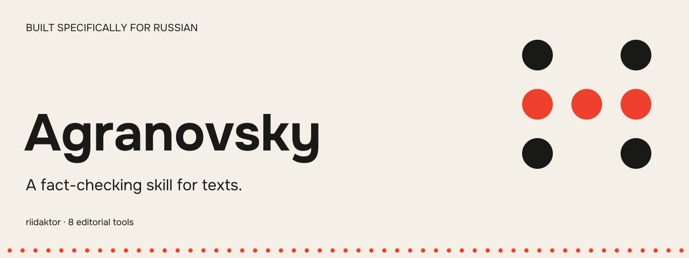
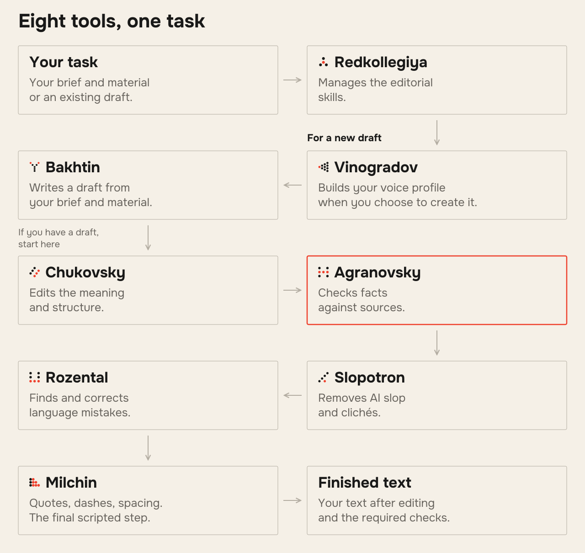

[Русский](README.md) · [English](README.en.md)

<picture>
  <source media="(prefers-color-scheme: dark)" srcset="assets/brand/cover-en-dark.svg">
  
</picture>

# Agranovsky

**Built specifically for Russian.** A fact-checking skill for texts. Checks numbers, dates, quotes and links, and shows sources.

[How to install](#how-to-install) · [Example tasks](#example-tasks)

## How it works

Give Agranovsky the text and any sources you have. It identifies verifiable claims, looks for original sources and checks numbers, dates, quotes and other facts against them. You get a report showing what is supported, what is wrong and what could not be verified.


## Example tasks

### Check a text before publication

> Check the numbers, dates, quotes and other verifiable claims in this text with Agranovsky. Show sources and separate claims you could not verify.

### Verify a quote

> Verify these quotes and their attribution for a article. Find original sources and compare wording and context. State clearly when an original is unavailable.

### Check data and links

> Check the figures and links in this text against primary sources. Check dates, units and whether each source supports the associated claim.


## How to install

### For agents

Claude Code, Codex / ChatGPT Desktop, Cursor, GitHub Copilot, Gemini CLI — give your agent this instruction:

```text
Install the Agranovsky skill:
https://github.com/beaverbeard/agranovsky

Use it whenever we write or edit texts.
```

<details>
<summary>More options</summary>

Agent-specific setup: [Claude Code](docs/OTHER-APPS.en.md#claude-code), [ChatGPT Desktop / Codex](docs/OTHER-APPS.en.md#codex), [Cursor](docs/OTHER-APPS.en.md#cursor), [GitHub Copilot](docs/OTHER-APPS.en.md#copilot), [Gemini CLI](docs/OTHER-APPS.en.md#gemini-cli).

### ChatGPT, Claude or Gemini in a browser

Download [this skill’s package](docs/downloads/agranovsky.zip). It includes the instructions, scripts and resources.

- **ChatGPT:** create a project and add the instructions and resources from the extracted package. [Step by step](docs/OTHER-APPS.en.md#chatgpt).
- **Claude:** enable code execution and upload the ZIP in Customize → Skills. [Step by step](docs/OTHER-APPS.en.md#claude).
- **Gemini:** open Customize → Skills → Create → Upload and upload the package. [Step by step](docs/OTHER-APPS.en.md#gemini).

Available stages depend on the tools in your app. [Check readiness](docs/OTHER-APPS.en.md#readiness).

### Better still: the whole Redkollegiya toolkit

Install [Redkollegiya](https://github.com/beaverbeard/redkollegiya) with all eight skills. It selects the tools for writing, editing and proofreading. Give your agent this instruction:

```text
Install Redkollegiya and the complete set of eight editorial skills:
https://github.com/beaverbeard/redkollegiya

Use them whenever we write or edit texts.
```

</details>


## When your input is needed

Unavailable originals and conflicting evidence stay visible in the report. A confident answer does not turn an unverified claim into a verified one.

## Inside the toolkit

Agranovsky handles one part of the writing workflow. Start with [Redkollegiya](https://github.com/beaverbeard/redkollegiya) for the complete process; it selects the tools for the task.

<picture>
  <source media="(prefers-color-scheme: dark) and (max-width: 600px)" srcset="assets/brand/system-map-en-dark-narrow.svg">
  <source media="(prefers-color-scheme: dark)" srcset="assets/brand/system-map-en-dark.svg">
  <source media="(max-width: 600px)" srcset="assets/brand/system-map-en-light-narrow.svg">
  
</picture>

These eight skills make up the writing toolkit. Below are their responsibilities and links to their repositories.

| Skill | What it helps you do |
|---|---|
| [Редколлегия / Redkollegiya](https://github.com/beaverbeard/redkollegiya) | Writes and edits texts, from the first draft through fact-checking and final proofreading. |
| [Виноградов / Vinogradov](https://github.com/beaverbeard/vinogradov) | Helps AI write in your style by analysing your texts and building an author voice profile. |
| [Бахтин / Bakhtin](https://github.com/beaverbeard/bakhtin) | Writes posts, emails and articles from your brief and material in the style you need. |
| [Чуковский / Chukovsky](https://github.com/beaverbeard/chukovsky) | Edits texts by improving structure, fixing gaps in logic and removing bureaucratic wording. |
| [Аграновский / Agranovsky](https://github.com/beaverbeard/agranovsky) | A fact-checking skill for texts. Checks numbers, dates, quotes and links, and shows sources. |
| [Слопотрон / Slopotron](https://github.com/beaverbeard/slopotron) | Clears out the AI slop and clichés everyone is sick of. |
| [Розенталь / Rozental](https://github.com/beaverbeard/rozental) | A proofreading skill: checks and corrects texts. Finds mistakes in spelling, punctuation and grammar. |
| [Мильчин / Milchin](https://github.com/beaverbeard/milchin) | A typography skill: formats text to Russian typesetting rules. Checks quotes, dashes and spacing. |

## The riidaktor newsletter

In riidaktor, we explore how to write and edit texts with AI.

Learn to give clearer briefs, retain your own voice and spot invented details. Take the techniques into your workflow to spend less time reworking drafts and publish with more confidence.

[Subscribe to the newsletter →](https://redaktozavr.ru/rAIdactor?utm_source=skills)


## Compatibility and source

Check the tools available in your app when setting up. The English page translates the documentation.

[SKILL.md](https://github.com/beaverbeard/agranovsky/blob/82113074cae5fa766dc0684dbbb6a30b842a96e3/.claude/skills/agranovsky/SKILL.md) · [MIT](https://github.com/beaverbeard/agranovsky/blob/82113074cae5fa766dc0684dbbb6a30b842a96e3/LICENSE)
